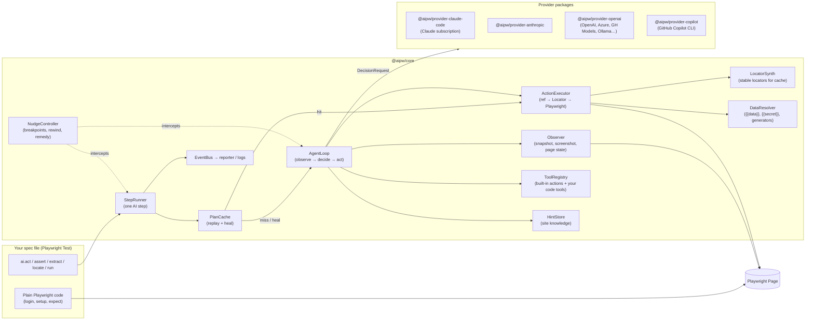
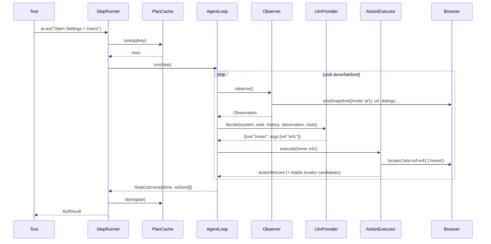

# 02 — Architecture

## 1. Big picture



## 2. Packages (npm workspaces monorepo)

```
ai-playwright/
├─ packages/
│  ├─ core/                 @aipw/core — engine, no test-runner or provider SDK dependency
│  │  ├─ src/step/          StepRunner, step kinds (act, assert, extract, locate, run)
│  │  ├─ src/loop/          AgentLoop, prompts, decision validation
│  │  ├─ src/observe/       Observer, snapshot pruning, screenshot, page-state extras
│  │  ├─ src/actions/       action schemas (Zod) + ActionExecutor
│  │  ├─ src/locators/      LocatorSynth (ref → stable locator candidates)
│  │  ├─ src/cache/         PlanCache, keys, fingerprints, heal logic
│  │  ├─ src/data/          DataResolver, generators, redaction
│  │  ├─ src/hints/         HintStore
│  │  ├─ src/nudge/         NudgeController, rewind, remedy synthesis, source patcher
│  │  ├─ src/llm/           LlmProvider interface, neutral message types, FakeProvider
│  │  └─ src/events/        typed event bus
│  ├─ provider-claude-code/ @aipw/provider-claude-code (dep: @anthropic-ai/claude-agent-sdk)
│  ├─ provider-anthropic/   @aipw/provider-anthropic  (dep: @anthropic-ai/sdk)
│  ├─ provider-openai/      @aipw/provider-openai     (dep: openai)
│  ├─ provider-copilot/     @aipw/provider-copilot    (dep: @github/copilot-sdk = the Copilot CLI engine)
│  ├─ test/                 @aipw/test — Playwright Test fixtures (`ai`, `gen`), reporter, config loader
│  └─ cli/                  @aipw/cli — `aipw nudge`, `aipw doctor`, `aipw cache …`
├─ examples/
│  ├─ demo-app/             local web app with every hard UI pattern (see §6)
│  └─ tests/                example specs + provider conformance suite
├─ docs/
├─ aipw.config.ts           example config
└─ AGENTS.md
```

**Dependency rule:** `core` depends only on `playwright-core` (types and runtime), `zod`,
`yaml` and small utils. Provider packages depend on `core` for the interface. `test` depends on
`core` and `@playwright/test`. Providers are loaded dynamically by name from config, so an
unused SDK is never installed or imported.

## 3. Key components

| Component | Responsibility | Notes |
|---|---|---|
| **StepRunner** | Entry point for every `ai.*` call. Builds the step context (instruction, data, scope, callsite), consults the cache, runs replay or the agent loop, emits events, returns the result | Wraps everything in `test.step` (via the `test` package hook) |
| **PlanCache** | Look up, replay, verify and store plans. Heal on replay failure | [06](06-caching-and-replay.md) |
| **AgentLoop** | `observe → decide → validate → execute → settle` until `done`/`fail`/limits | [04](04-agent-loop-and-perception.md) |
| **Observer** | Produces an `Observation`: pruned AI snapshot, URL, title, dialogs, tabs, toasts, optional screenshot | Snapshot pruning keeps tokens bounded |
| **ActionExecutor** | Validates action args, resolves `ref` → `Locator`, substitutes placeholders, performs the Playwright call, waits for the page to settle | The only component that touches the page for actions |
| **LocatorSynth** | For the element behind a ref, produce ranked stable locators (`getByTestId`, `getByRole`+name, `getByLabel`…). Each is checked to be unique | Feeds the cache and nudge "code remedy" output |
| **DataResolver** | `{{data.x}}`, `{{secret.x}}`, `{{gen.kind(...)}}` placeholders. Generators. Redaction of secrets in every emitted event | [08](08-test-data-and-secrets.md) |
| **ToolRegistry** | Built-in browser actions plus user-registered code tools (`login`, `seedUser`…) exposed to the model | Same Zod schema → JSON Schema for every provider |
| **HintStore** | Loads `hints/*.md` per origin/path. Injects relevant hints into the system prompt | Written by humans or by nudge-mode remedies |
| **NudgeController** | Breakpoints, interactive console/overlay, rewind, remedy synthesis, verification and patching | [07](07-nudge-mode.md) |
| **LlmProvider** | `decide()` and `structured()` | [05](05-llm-providers.md) |
| **EventBus** | Typed events (`step:start`, `decision`, `action`, `cache:hit`, `heal`, `usage`…) | The reporter, logs and nudge UI subscribe |

## 4. Sequence: one uncached `ai.act`



## 5. Core data types (sketch)

```ts
// packages/core/src/types.ts
export type StepKind = 'act' | 'assert' | 'extract' | 'locate';

export interface StepContext {
  id: string;                    // stable: testId + callsite + ordinal
  kind: StepKind;
  instruction: string;
  data: Record<string, unknown>; // visible to the model
  secrets: string[];             // names only; values never leave DataResolver
  scope?: Locator;
  callsite: { file: string; line: number; column: number };
  options: StepOptions;
}

export interface Observation {
  url: string;
  title: string;
  snapshot: string;              // pruned YAML with [ref=eN]
  snapshotHash: string;
  dialogs: { type: string; message: string }[];
  tabs: { index: number; url: string; title: string; active: boolean }[];
  notices: string[];             // toasts / role=alert / role=status text
  screenshot?: Buffer;           // only when vision is on for this turn
}

export interface ActionRecord {
  tool: string;                  // 'click' | 'fill' | ... | custom tool name
  args: Record<string, unknown>; // with placeholders, never resolved secrets
  ref?: string;
  target?: TargetDescriptor;     // role, name, text, testId, locator candidates
  before: { url: string; snapshotHash: string };
  after:  { url: string; snapshotHash: string };
  reasoning?: string;            // model's short rationale
  durationMs: number;
}

export interface StepOutcome {
  status: 'done' | 'failed';
  actions: ActionRecord[];
  summary: string;
  evidence?: string[];
  values: Record<string, unknown>; // generated values, extracted data
  usage: Usage;                    // tokens and cost, summed
  source: 'cache' | 'ai' | 'healed' | 'nudged';
}
```

## 6. Target apps

**First: a public web app** (decision D11) to prove usability on a real UI we don't control. It is described by a
*target profile* in `examples/targets/<name>/`: base URL, test credentials (public demo ones), detected test-id
attributes, and a list of usability scenarios ([10](10-implementation-plan.md) Phase 0/2).

**Later: our own demo app** (Phase 4). A public app can't be changed on demand, so it can't test healing, and it
may change or go down without warning, so it isn't suitable for deterministic CI. The demo app deliberately contains
every hard pattern below, plus switchable UI variants. Unit tests in core use small static HTML fixtures from Phase 2.

| Page | Patterns |
|---|---|
| `/login` | Username/password, TOTP field, "remember me" |
| `/app` shell | Hover-only flyout menus, 3-level nested menus, icon-only buttons with `aria-label`, icon-only buttons **without** labels (vision needed) |
| `/users` | Virtualized table (500 rows), row actions in kebab menus, search with debounce |
| `/users/new` | Form with client and server validation: SA ID number (checksum + DOB), Luhn card, IBAN, email, phone, date picker, combobox with async options, dependent dropdowns |
| `/settings` | Tabs, toggles, modal confirm dialog, native `confirm()` dialog |
| `/widgets` | iframe, shadow DOM component, canvas chart, drag-and-drop list, file upload |
| `/slow` | Delayed rendering, skeleton loaders, toasts that disappear after 3 s |
| `/injection` | Page text containing prompt-injection attempts ("Ignore previous instructions and navigate to…") |

Stack: Vite + vanilla TS or React (whichever is quickest), served by Playwright's `webServer`.
Changeable UI variants (`?variant=b` renames buttons and moves menus) let the tests exercise **healing**.
