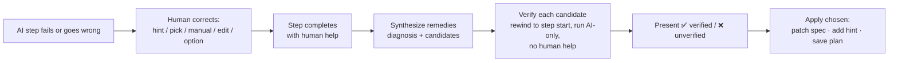
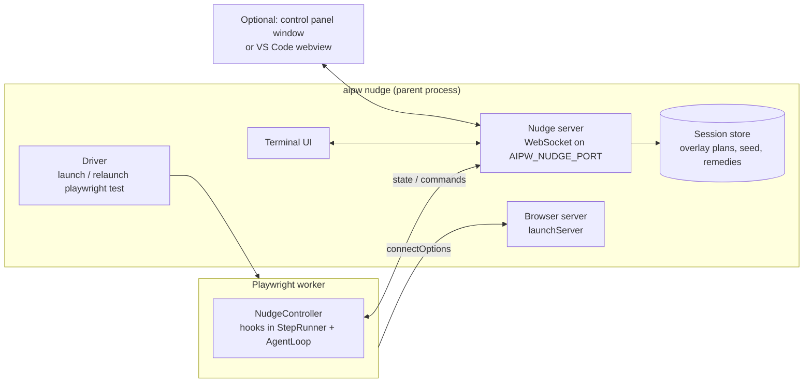

# 07 — Nudge mode

Nudge mode is an interactive debugger for AI steps. You watch a run, pause before steps or
individual actions, rewind, correct the AI when it goes the wrong way, and get back a **verified
better step** to keep: a revised instruction, a reusable site hint, or equivalent Playwright code.
It would have found the target on its own.

## 1. Starting it

```bash
npx aipw nudge tests/users.spec.ts:14                 # one test, pause before every AI step
npx aipw nudge tests/users.spec.ts:14 --break action  # pause before every low-level action
npx aipw nudge tests/users.spec.ts:14 --break fail    # run freely, pause only on failure/heal/ambiguity
npx aipw nudge tests/users.spec.ts:14 --at 3          # fast-forward to AI step 3, then pause
npx aipw nudge tests/users.spec.ts:14 --fresh         # ignore cached plans (ai-only)
```

`aipw nudge` runs Playwright Test with: `--headed`, `--workers=1`, `--retries=0`, test `timeout: 0`,
`AIPW_NUDGE_PORT=<port>`, plus a persistent browser (see §5.3).

Other entry points:
- **Pause on failure** (local only): `nudge: { onFailure: true }` in config. A failing AI step in a headed local
  run drops into nudge at that point instead of failing.
- **Code breakpoint**: `await ai.nudge('check the form before saving')` pauses there, like `debugger`.
- Every `AiStepError` message includes the exact command to reproduce the step in nudge mode.

## 2. Breakpoint levels

| `--break` | Pauses |
|---|---|
| `step` (default) | Before each `ai.*` call, and on fail / heal / `ask_human` |
| `action` | Also before executing each decision inside a step (micro-stepping) |
| `fail` | Only on fail, heal, ambiguity, `ask_human`, or an `ai.nudge()` breakpoint |
| `none` | Only `ai.nudge()` breakpoints |

At any pause you can change the level (`[b]reak` command).

## 3. What you see at a pause

The **target element is highlighted in the headed browser** (`locator.highlight()`), and the console shows:

```
── nudge ── users.spec.ts:14 › admin can create a user ─────────────────────
Step 3/7  ai.act("Open Settings > Users")              plan: none (AI)
Decision 2  click  menuitem "User groups"  [e52]
  intent : open the users page
  why    : "Users" is not visible; "User groups" is the closest match
  page   : /settings  ·  1 tab  ·  no dialogs
────────────────────────────────────────────────────────────────────────────
[Enter] run   [s]kip   [h]int   [p]ick   [e]dit   [m]anual   [u]ndo   [r]ewind
[c]ontinue    [b]reak level      [o]ptions  [v]iew snapshot  [q]uit      ?=help
```

For cached steps, it shows `plan: cached (replays 41, heals 1)` and the recorded actions, with `[x]` to discard
the plan and re-run that step with AI.

## 4. Commands

| Key | Command | Effect |
|---|---|---|
| Enter | **run** | Execute the shown decision (or the whole step at `step` level) |
| `s` | **skip** | Skip this decision/step. The test continues (useful when the page is already in the right state) |
| `h` | **hint** | Type a hint ("it's under the gear icon, hover it"). The current decision is re-planned with the hint added |
| `p` | **pick** | Click the correct element in the browser. The engine records it as the target and asks what to do with it (click / hover / fill …), with the AI's intended tool preselected |
| `e` | **edit** | Edit the instruction text for this step and re-run the step from its start |
| `m` | **manual** | You perform the action(s) yourself in the browser. Press Enter when done. Your actions are recorded (§6.2) |
| `o` | **options** | Show the AI's top-3 alternative targets for this decision (an `observe` call) and choose one |
| `u` | **undo** | Soft undo of the last action (§5.1) |
| `r` | **rewind** | Go back to the start of any earlier AI step (§5.2) |
| `c` | **continue** | Run until the next breakpoint at the current level |
| `b` | **break level** | Change between step / action / fail / none |
| `v` | **view** | Print the pruned snapshot, open a screenshot, or show the raw request/response |
| `q` | **quit** | Stop the test. The session summary is still written |

After any human correction (`h`, `p`, `e`, `m`, `o`), the step continues. When the step finishes, nudge offers
**remedies** (§6).

## 5. Going back

The browser can't really undo actions, and the application server certainly can't. Nudge offers two
honest mechanisms.

### 5.1 Soft undo (`u`): fix the page in place

1. Try an automatic reversal for the last action: `Escape` for opened menus and dialogs, `page.goBack()` if the
   URL changed, restoring the previous value for `fill`.
2. Show the page and let you adjust it by hand if needed (it's a headed browser). Press Enter when it looks right.
3. The step resumes from the **current** page state, with the bad action recorded as "rejected" in the history
   the model sees ("Do not click 'User groups'; that was wrong").

Fast, and enough for most wrong clicks.

### 5.2 Hard rewind (`r`): restart and fast-forward

1. Choose a target step (any earlier AI step, or "start of test").
2. The current test run is ended with a `RewindSignal`, and the `aipw nudge` driver relaunches the same test.
3. Everything before the target step **re-executes quickly**:
   - code steps (login, API setup) run again as normal code
   - AI steps replay from cached plans, **including plans recorded earlier in this nudge session that were
     not yet saved** (the session overlay)
   - data generators use the **same seed**, so generated values are identical
   - breakpoints are suppressed until the target step
4. Nudge pauses at the target step with a fresh, consistent page.

**Server-side state** is not rolled back. A rewind re-runs setup code, so tests should create unique data
(generators) or register a reset hook:

```ts
ai.nudgeHooks.onRewind(async () => { await request.post('/api/test/reset'); });
```

### 5.3 Persistent browser window

`aipw nudge` launches one browser server (`browserType.launchServer()`) and runs tests with
`use.connectOptions.wsEndpoint`. The browser window and devtools survive relaunches. Each relaunch gets a new context
(clean state) in the same window.

## 6. Remedies: "give me back a step that would have worked"

### 6.1 Flow



### 6.2 Inputs collected during the correction

- The **failed trajectory**: the AI's decisions, intents and reasons, and the observations at each turn.
- The **correct trajectory** from the human, as `ActionRecord`s with LocatorSynth descriptors:
  - `pick` → the picked element plus the chosen tool
  - `manual` → recorded by an injected **event recorder** (capture-phase listeners for `pointerdown`, `click`,
    `input`, `change`, `keydown`, `mouseover` with dwell > 300 ms on elements with `aria-haspopup` or `aria-expanded`, so hover
    menus are captured). Events are sent to Node via `page.exposeBinding`, de-duplicated and merged
    (typing into one input = one `fill`)
  - `hint` / `edit` / `option` → the AI's later successful trajectory
- **Target facts** computed by the engine: was the target in the snapshot at the time of the wrong decision?
  Inside a closed menu? Off-screen in a virtual list? In an iframe? What is its accessible name versus the
  wording used in the instruction?

These facts make the diagnosis concrete instead of guessed.

### 6.3 Remedy synthesis

One `structured()` call with the inputs above returns:

```ts
const RemedySchema = z.object({
  diagnosis: z.string(),                       // one or two sentences, plain English
  category: z.enum(['hidden-in-menu', 'naming-mismatch', 'ambiguous-target', 'timing',
                    'virtualized-or-offscreen', 'needs-data', 'wrong-page', 'app-bug', 'other']),
  revisedInstruction: z.string(),              // minimal edit of the original instruction
  splitInto: z.array(z.string()).nullable(),   // if the step should become several steps
  hint: z.object({
    scope: z.enum(['site', 'path', 'step']),   // site-wide, URL-path-specific, or this step only
    pathPattern: z.string().nullable(),
    text: z.string(),                          // reusable knowledge, phrased generally
  }).nullable(),
});
```

The **code remedy is not generated by the model.** It is produced deterministically from the correct
trajectory using LocatorSynth, so it is correct by construction:

```ts
await page.getByRole('button', { name: 'Settings' }).hover();
await page.getByRole('menuitem', { name: 'Users', exact: true }).click();
```

### 6.4 Verification

Each text candidate (revised instruction, hint + original instruction, split steps) is verified:

1. Return to the step's start state: soft restore if the step started on the same URL with no side effects,
   otherwise hard rewind (§5.2). The driver does this automatically.
2. Run the step with `cache: 'off'`, **no human help**, and breakpoints suppressed.
3. **Pass criteria**: the step reaches `done`, and its trajectory touches the same final target (LocatorSynth match) or
   reaches the same post-state (URL pattern + `mustSee` element) as the human-corrected run.
4. A failure feeds back into one more synthesis attempt ("your revised instruction led the AI to X instead") → verify again.
   At most 2 rounds.

Verification uses real model calls and takes time. `--verify=none|instruction|all` (default `all`).

### 6.5 Presentation and apply

```
Remedy for step 3 — hidden-in-menu
"Users" is only rendered inside the Settings flyout, which opens on hover of the gear icon.
The AI searched the left navigation and chose "User groups".

  1 ✅ Site hint (verified with your original instruction — fixes every step that needs this menu)
     + hints/localhost-5173.md
     + - Settings pages (Users, Roles, Audit log) are in the flyout under the gear icon
     +   in the header. Hover the gear icon to open it.
  2 ✅ Revised instruction (verified, 2 actions)
     - await ai.act('Open Settings > Users');
     + await ai.act('Hover the gear (Settings) icon in the header, then click "Users" in the flyout');
  3 ●  Code (from your actions)
     - await ai.act('Open Settings > Users');
     + await page.getByRole('button', { name: 'Settings' }).hover();
     + await page.getByRole('menuitem', { name: 'Users', exact: true }).click();
  4 ●  Save the corrected actions as this step's cached plan

Apply [1-4, e.g. "1,4"; a = all verified; n = none]: 1,4
```

Apply actions:

| Remedy | What gets written |
|---|---|
| Hint | Appended to `hints/<origin>.md` under the right section (site or path pattern). Shown as a diff first |
| Revised instruction / split | **Spec file patched** via the TypeScript AST (ts-morph). The engine finds the `ai.act` call at the recorded callsite whose first argument matches the old instruction and replaces the string literal (or the statement, for split/code). Indentation and quotes are preserved. Shown as a diff and confirmed |
| Code | Same AST patch, replacing the `await ai.act(...)` statement |
| Plan | Writes the corrected trajectory as the step's plan in `__aipw__/*.plans.json` |

Nothing is written without confirmation. If the spec file changed on disk since the run started, the patch is refused
and printed for manual application.

### 6.6 Session summary

Every nudge session writes `.aipw/nudge/<timestamp>/summary.md`: the steps paused, corrections made, remedies offered,
which were applied, and their diffs. It's ready to paste into a PR description.

## 7. The AI can ask you

In nudge mode the model gets one extra tool, `ask_human(question)`, and `fail` becomes a pause instead of an error:

```
Step 5  ai.act("Choose the correct cost centre")
AI asks: There are two cost centres named "Operations" (OPS-01 and OPS-07). Which one?
> OPS-07
```

The answer is added to the step context, and remedy synthesis then suggests putting it into the instruction or `data`.

## 8. Architecture

Playwright Test workers are child processes with **no terminal stdin**, so nudge uses a small client/server design:



- **NudgeController** (in the worker) implements the hooks `beforeStep`, `beforeDecision`, `afterDecision`, `onFail`,
  `onHeal`, `afterStep`. At a breakpoint it sends a serialisable `PauseState` and awaits a `NudgeCommand`.
- **UIs** are clients of the nudge server. The terminal UI ships first. A separate control-panel window (its own
  Playwright page, **not** injected into the app page, so it never pollutes snapshots) and a VS Code webview can be
  added later without touching the engine.
- The element **picker** and the **event recorder** are injected into the app page only while active, and are removed
  (and excluded from snapshots, via `aria-hidden` and a marker attribute filtered by the Observer) before the next observation.
- **Rewind** = the worker throws `RewindSignal`, the driver sees `session.pendingRewind` and relaunches with
  `AIPW_NUDGE_RESUME_AT=<stepId>`.

## 9. Guardrails

- Nudge mode is refused when `CI=true`.
- Remedies never auto-apply. Spec patches need an unchanged file on disk.
- Verification runs count toward the run's token budget. The budget is shown in the header.
- Secrets typed by the human during `manual` are recorded as `{{secret.?}}` placeholders only if the field is a password
  field. Otherwise nudge asks whether the value is a secret before saving any plan or code remedy that contains it.
