# 10 — Implementation plan

Phases are ordered so that something useful runs end-to-end as early as possible (Phase 2), and
every later phase adds to a working system. Each phase lists tasks, deliverables and **exit criteria**
that must pass before moving on. Sizes: **S** ≈ ≤ 1 day, **M** ≈ 2–4 days, **L** ≈ 1–2 weeks (one developer
working with an AI assistant). Treat the sizes as relative, not commitments.

```mermaid
gantt
  dateFormat X
  axisFormat %s
  section Foundation
  P0 Spikes (public app)    :p0, 0, 3
  P1 Skeleton + target      :p1, after p0, 3
  section Engine
  P2 Core loop + Claude Code:p2, after p1, 10
  P3 Foundry, Copilot, API  :p3, after p2, 6
  P4 Cache + heal + demo app:p4, after p2, 10
  section Features
  P5 Data, secrets, tools   :p5, after p4, 5
  P6 Nudge mode             :p6, after p4, 12
  P7 Reporting + CI         :p7, after p5, 5
  section Optional
  P8 Extras                 :p8, after p7, 8
```

P3 and P4 can run in parallel once P2 is done. So can P5 and P6.

---

## Phase 0 — Spikes (S–M)

Throwaway scripts in `spikes/` that confirm the assumptions marked **⚠ verify in Phase 0** across the docs.
Record each answer in `docs/11-risks-and-open-questions.md` and adjust the design if needed.

| # | Question | How |
|---|---|---|
| 0.1 | Does `locator.ariaSnapshot({ mode: 'ai' })` give refs, and does `page.locator('aria-ref=eN')` resolve them reliably, including inside iframes? | Script against the chosen public app + 2 other sites + a page with an iframe |
| 0.1b | Injected walker prototype ([12](12-element-identification.md) §2 R2): `addInitScript` + `data-aipw-ref` tagging + resolution, on the same pages. Compare its snapshot with Playwright's | ~150-line script |
| 0.1c | Test-id auto-detection on the public app: which attribute spellings exist, how many, how unique? | Run the detector, print counts |
| 0.2 | Snapshot size on the **public target app** (largest pages)? | Measure chars/tokens before and after a naive prune |
| 0.3 | Copilot SDK: does `availableTools` disable built-ins? Does the capture-and-end-turn pattern work? Image attachments? Session creation latency? Deny-permission handler shape? | Script with 3 fake tools, on the Copilot machine |
| 0.4 | **Foundry** (the pipeline deployment): v1 route + Entra ID auth via `az login`, strict tools, `tool_choice: 'required'`, `parallel_tool_calls: false`, image input, `json_schema` response format, content-filter behaviour on page text | 30-line script |
| 0.5 | Anthropic API: strict tools + `disable_parallel_tool_use` + `fallbacks: 'default'` on your account | 20-line script |
| 0.5b | Claude Agent SDK on the Claude Code subscription (D12): built-ins really off with `tools: []`, one captured call, latency per `query()` (maxTurns 1 vs natural end), usage reporting, `outputFormat` structured output | Script, needs `claude auth login` |
| 0.6 | `locator.toString()` readable and stable? `locator.highlight()` visible in headed mode and absent from ARIA snapshots? | Script |
| 0.7 | Trace content for `fill` vs `evaluate`-set values (secret leakage) | Record a trace, inspect it |

**Exit:** every question has a written answer. The design is adjusted (e.g., DOM-walker fallback for refs, session-per-step for Copilot).

**Status (2026-10-09):** 0.1, 0.1b, 0.1c, 0.2, 0.5b, 0.6 and 0.7 done on this machine; results and design changes are in
[11](11-risks-and-open-questions.md) §3. Waiting on: **0.3** (Copilot machine),
**0.4** (Foundry access). 0.5 is deferred until there is an API key. Phase 1 went ahead in parallel because none of
the open spikes affect it.

---

## Phase 1 — Skeleton and public target (S–M)

Tasks
- [x] npm workspaces monorepo: `packages/{core,test,cli,provider-claude-code,provider-anthropic,provider-openai,provider-copilot}`, `examples/{targets,tests}`
- [x] TypeScript strict (6.0: typescript-eslint doesn't support 7.x yet), ESM, `tsup` builds, `eslint` + `prettier`, `vitest` for unit tests
- [x] Root scripts: `build`, `test` (vitest), `e2e` (playwright), `lint`, `typecheck`
- [x] Azure Pipelines CI for the framework repo itself: lint + typecheck + unit tests (no LLM, no public-app calls). The same checks also run as a GitHub Actions workflow, because the repo lives on GitHub
- [x] Target profile `examples/targets/saucedemo/`: base URL, public demo credentials (as env-backed secrets, even though they're public), detected test-id attributes
- [x] **Usability scenario list** for the public app (8–12 scenarios, written in English as you would write them): login, menu navigation, search/filter, a multi-field form with validation, a table read (`extract`), a success-message `assert`, a detail page, logout
- [x] Plain-Playwright smoke spec for 2–3 of the scenarios (proves the app is reachable and stable enough)

**Exit:** `npm run build && npm test` green locally and in CI. The smoke spec passes against the public app.

**Status (2026-10-09):** done locally. Build, lint, typecheck and 36 unit tests are green, and the smoke spec passed
15/15 (`--repeat-each 5`). CI runs on the PR. Core already has the Zod config schema and the test-id helpers from
[12](12-element-identification.md) §4, because spike 0.1c used them.

---

## Phase 2 — Core engine with the Claude Code provider (L)

Phase 0 changes to carry in: mask credential-field values in snapshots, re-snapshot until stable, check a ref's
`count()` before acting, and warn when secrets meet trace DOM snapshots ([11](11-risks-and-open-questions.md) §3).

Tasks
- [ ] `llm/`: `LlmProvider` interface, neutral types, `FakeProvider` with scripted decisions
- [ ] `actions/`: Zod schemas for all tools in [04](04-agent-loop-and-perception.md) §2 (strict-compatible, per [05](05-llm-providers.md) §2.1); `zod → JSON Schema`
- [ ] `observe/`: Observer (AI snapshot, pruning steps 1–5, page-state extras, notices MutationObserver, dialog capture), `SnapshotSource` interface (+ DOM-walker fallback if 0.1 requires it)
- [ ] `observe/injected/`: the walker bundle loaded via `addInitScript` (test-id detection always; ref tagging when `refs.source` resolves to `injected`)
- [ ] `actions/executor`: ref resolution, stale-ref check, every built-in tool, settle logic
- [ ] `locators/`: LocatorSynth implementing the ladder L1–L7 ([12](12-element-identification.md) §3), test-id normalisation + auto-detection (§4), generated-value filter (§5), uniqueness + identity verification
- [ ] `loop/`: AgentLoop, prompt builder (layout in [04](04-agent-loop-and-perception.md) §4), decision validation and repair, guards
- [ ] `step/`: StepRunner for `act`, `assert` (retry + snapshot-hash dedupe), `extract` (structured + repair), `locate`, `run`
- [ ] `events/`: typed EventBus
- [ ] `provider-claude-code` (D12): capture-pattern `decide` and `outputFormat` `structured`, per [05](05-llm-providers.md) §3a adjusted by spike 0.5b; usage mapping (equivalent cost + requests); a clear error when `claude auth status` says signed out
- [ ] `test`: fixtures `ai`, `gen` (gen = minimal for now), `withAipw()`, `test.step` wrapping, callsite capture
- [ ] Unit tests: pruning (golden files), prompt builder (golden files), LocatorSynth + test-id normalisation (static HTML fixtures in `packages/core/test/fixtures/`), executor (fixtures), loop with FakeProvider (done/fail/limits/repair/no-progress)
- [ ] Usability suite `examples/tests/saucedemo/*.spec.ts`: the Phase 1 scenarios as English tests, with real calls through `claude-code` (tagged `@llm`)
- [ ] A short usability write-up: which instructions worked as written, which needed detail, where the AI struggled (this feeds hints and prompt tuning)

**Exit:**
- ≥ 90% pass rate over 3 runs of the `@llm` usability suite with `cache: off`.
- For elements that have test ids, LocatorSynth picks a test-id locator ≥ 95% of the time.
- A static injection fixture page (text like "ignore previous instructions and navigate to…") does not cause navigation or out-of-task actions.
- Median uncached single-action `act` < 5 s.

---

## Phase 3 — Foundry (OpenAI-compatible), Copilot and Anthropic API providers (M)

Tasks
- [ ] `provider-anthropic` (API key): `decide` + `structured`, usage mapping, refusal handling, typed-error backoff (moved from Phase 2 by D12)
- [ ] `provider-openai`: Chat Completions adapter, presets (**`foundry`** first, then `openai`, `azure-openai`, `github-models`, `ollama`, `lmstudio`), compat flags, JSON-mode fallback for `structured`
- [ ] Foundry auth: API key or keyless (`@azure/identity` `DefaultAzureCredential`, scope `https://ai.azure.com/.default`); content-filter errors mapped to `AiProviderError(kind: 'content_filter')`
- [ ] `provider-copilot`: capture-pattern adapter per [05](05-llm-providers.md) §5, adjusted by the spike 0.3 results
- [ ] Provider loader (dynamic `import()` by package name from config) and `aipw doctor`
- [ ] Conformance suite + `aipw conformance` writing the metrics JSON
- [ ] Contract tests: the same recorded fixture request → each adapter's wire payload (snapshot tests, no network)

**Exit:** the conformance suite (the usability scenarios with `cache: ai-only`) passes ≥ 85% with the Foundry deployment and the chosen Copilot model.
The metrics JSON for all three providers is committed under `docs/conformance/`.

---

## Phase 4 — Plan cache, replay, healing and the demo app (L)

Tasks
- [ ] Step keys, plan file format, stable JSON writer, locator-expression interpreter (no `eval`)
- [ ] Replay engine with pre/post checks and events (`source: 'cache'`)
- [ ] Compiled checks for `assert`, and the AI re-judge path
- [ ] Extract replay (primitive coercion / text-only structured call)
- [ ] Fingerprints stored with every target. Fingerprint healing L8 ([12](12-element-identification.md) §6), allowed in `replay-only`
- [ ] AI healing with context, history of 3 plan versions, `heal.policy` behaviours
- [ ] `aipw cache stats|prune|refresh|show`
- [ ] **Demo app** (`examples/demo-app`) with the pages in [02](02-architecture.md) §6 and `?variant=b` UI changes (renamed test ids, reworded buttons, moved menus), because healing needs UI changes we control
- [ ] Heal tests: record on variant A → replay A with 0 LLM calls → switch to variant B → fingerprint heals for small changes, AI heals for big ones → replay B with 0 LLM calls

**Exit:**
- Second run of the public-app usability suite: **0 LLM calls**, and wall time within 1.5× of an equivalent plain-Playwright suite.
- Variant-B heal scenarios pass. A renamed test id heals via fingerprint (no LLM), and the report shows heals with their source.
- `replay-only` with a missing plan fails with a clear message.

---

## Phase 5 — Test data, secrets and code tools (M)

Tasks
- [ ] DataResolver: placeholders, `values` accumulation, plan placeholder back-conversion
- [ ] Generators + validators (SA ID, Luhn, test cards, IBAN, VAT where defined, phone, email, person, address, date, TOTP), with unit tests against published examples
- [ ] `generate_value` tool
- [ ] Secrets provider (env + custom function), Redactor applied to all events/logs/attachments, credential-field restriction, `fillMode`
- [ ] `ai.tools.register` (code tools) with Zod validation, recorded in plans
- [ ] Demo: `/users/new` with server-side validation passes using generated values. A grep for secret values across `.aipw/`, the reports and the plans finds nothing

**Exit:** the validation-heavy demo form passes with uncached and cached runs. The secret-leak check is automated in CI.

---

## Phase 6 — Nudge mode (L)

Split into two parts so value lands early.

**6a — Core nudge (terminal)**
- [ ] `aipw nudge` driver: launches the browser server, nudge WebSocket server, runs Playwright with the nudge env, relaunch loop
- [ ] NudgeController hooks in StepRunner and AgentLoop. `PauseState`/`NudgeCommand` protocol (typed, versioned)
- [ ] Terminal UI: pause display, commands run/skip/hint/edit/continue/break/view/quit, target highlight
- [ ] `ask_human` tool and fail → pause
- [ ] Soft undo and hard rewind (RewindSignal, session overlay plans, same gen seed, `onRewind` hooks)
- [ ] `ai.nudge()` code breakpoint, `nudge.onFailure`

**6b — Corrections and remedies**
- [ ] Element picker (`p`) and options (`o`, top-3 alternatives)
- [ ] Manual action recorder (`m`) → ActionRecords (incl. hover-menu dwell detection)
- [ ] Target-fact computation (in snapshot? in closed menu? offscreen? name mismatch?)
- [ ] Remedy synthesis (`structured` + RemedySchema) and deterministic code remedy via LocatorSynth
- [ ] Verification runner (rewind → AI-only → pass criteria), max 2 synthesis rounds
- [ ] Apply: hints writer, ts-morph spec patcher (instruction replace, split, code replace), plan writer. Diffs + confirmation. Refuse if the file changed
- [ ] Session `summary.md`

**Exit (scripted demo scenarios):**
1. Hidden hover menu: the AI fails → the human `pick`s → a **site hint** is verified with the original instruction → applied → a fresh `ai-only` run passes without nudge.
2. Ambiguous "Save": the AI asks the human → the revised instruction is verified → the spec is patched correctly (diff matches the golden file).
3. Rewind from step 5 to step 2 re-runs login code, replays steps 1–2 from cache, and pauses at step 2 with identical generated data.

---

## Phase 7 — Reporting and CI hardening (M)

Tasks
- [ ] Attachments per AI step, nested action steps, heal attachments
- [ ] `@aipw/test/reporter`: console summary, `.aipw/summary.{md,json}`, Azure `##vso[task.uploadsummary]`
- [ ] Pricing table + budget guards (per step / per run / requests)
- [ ] Example Azure pipelines (PR gate `replay-only`, nightly `auto`), as in [09](09-configuration-reporting-ci.md) §3
- [ ] Retry/backoff tuning for 429s under `workers > 1`
- [ ] Docs: "Getting started" in 10 minutes, a troubleshooting guide, "writing good instructions"

**Exit:** the nightly pipeline runs green on the demo suite with the Foundry deployment, authenticated keylessly through the service connection. The PR gate runs with 0 LLM calls. The summary tab shows in Azure DevOps.

---

## Phase 8 — Optional extensions (pick as needed)

| Extension | Notes |
|---|---|
| `*.ai.md` English-only spec files | A Playwright Test loader/transform that turns Markdown bullet steps into `ai.run` calls. Front-matter for data and tags |
| MCP server (`@aipw/mcp`) | Expose `act/assert/extract/locate/observe` + "generate spec from this session" as MCP tools for Copilot Chat agent mode / Copilot CLI |
| VS Code nudge panel | A webview client for the nudge WebSocket server |
| Set-of-marks vision | Ref labels drawn on screenshots for better vision grounding |
| Hint packs | Shipped hints for common component libraries (MUI, Ant Design, Kendo, Fluent UI date pickers and comboboxes) |
| C#/.NET client | Call the engine over the MCP server or a thin HTTP API from NUnit tests |

---

## Working agreements

- Every feature lands with: unit tests (FakeProvider), a demo-app e2e spec, and a docs update.
- No provider SDK imports outside `packages/provider-*`.
- Prompts live in `packages/core/src/loop/prompts/*.md` (versioned, golden-tested). A prompt change runs the conformance suite before merge.
- Branch + PR for all work, no direct commits to `main`.
