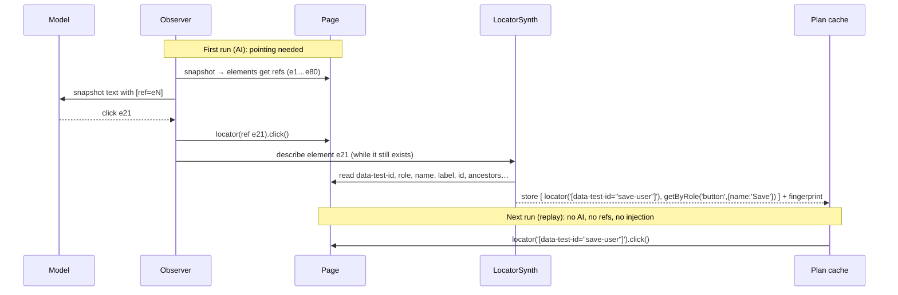

# 12 — Element identification

## 1. Two different problems

"Identifying an element" covers two separate jobs, and mixing them up makes injection sound harder than it is.

| | **Pointing** | **Finding again** |
|---|---|---|
| Question | "Which element in the snapshot I just showed you do you mean?" | "Where is the Save button?", asked next week on a fresh page load with no AI |
| Used by | The model, during one AI decision | Cache replay, `ai.locate`, nudge code remedies, healing |
| Lifetime | One observation (a few seconds) | As long as the UI doesn't change |
| Mechanism | **Refs** (`e12`): short handles, possibly injected into the page | **Locators**: test ids, role + name, label… (§3) |
| Needs AI running? | Yes, only exists during AI decisions | **No** |

**Injection only solves pointing.** It happens inside the Observer, immediately before a snapshot is sent to the
model, and that only happens when the AI is deciding. The moment an action is performed on a ref'd element, the engine
converts that element into **durable locators** (test id first) and stores those. Replays never see a ref.



## 2. Pointing: where refs come from

### R1 — Playwright's AI snapshot (preferred if spike 0.1 passes)

`locator.ariaSnapshot({ mode: 'ai' })` returns YAML with `[ref=eN]`, and `page.locator('aria-ref=eN')` resolves it.
Playwright does the "injection" itself: its injected script keeps a ref → element map inside the page. Nothing
for us to build.

Limitation: we don't control what's in the snapshot text (e.g., test ids aren't shown to the model). That's fine.
The model doesn't need test ids to choose an element; LocatorSynth reads them afterwards.

### R2 — Our own injected walker (fallback, or upgrade)

Used if `aria-ref` turns out to be unreliable or unavailable, or if we want richer snapshots (test ids, generated-id
filtering and pruning done in-browser). **How the injection works:**

1. **Register once per browser context** (no AI involved, costs nothing when idle):
   ```ts
   await context.addInitScript({ path: require.resolve('@aipw/core/dist/injected/walker.js') });
   ```
   Playwright runs this script in **every page and every frame, on every navigation**, before the app's own scripts.
   It only *defines* `window.__aipw`. It doesn't touch the DOM until asked.

2. **At observe time (AI decisions only)**, the Observer asks each frame for a snapshot:
   ```ts
   const yaml = await frame.evaluate((opts) => window.__aipw.snapshot(opts), { root, maxDepth, frameIndex });
   ```
   Inside the page, `snapshot()`:
   - removes stale markers from the previous observation (`[data-aipw-ref]` → `removeAttribute`)
   - walks the DOM, including open shadow roots
   - keeps "interesting" nodes: interactive roles, form fields, landmarks, headings, labelled text, table rows
   - computes role and accessible name (bundled `dom-accessibility-api`)
   - tags each kept element: `el.setAttribute('data-aipw-ref', 'f0e12')` (frame-prefixed)
   - returns the YAML lines, e.g. `- button "Save" [ref=f0e12] [testid=save-user]`

3. **Resolve a ref** with a normal Playwright locator, so auto-waiting and actionability checks still apply:
   ```ts
   frame.locator('[data-aipw-ref="f0e12"]')
   ```

4. **Convert immediately**: after the action, LocatorSynth builds durable locators for the element (§3) and the
   ref is forgotten.

Details:
- The Observer's DOM-quiet detector ignores mutations to the `data-aipw-ref` attribute, so our own tagging doesn't count as page activity.
- `refs.mode: 'handle'` is a non-mutating alternative for apps that react badly to attribute changes. Refs map to
  `WeakRef<Element>` in `window.__aipw`, and resolution uses `frame.evaluateHandle(...)`. You lose the locator auto-retry,
  so it's opt-in.
- Cross-origin iframes: `addInitScript` runs in them too. The Observer walks `page.frames()` and evaluates in each.
- This only ever runs in the test browser. Nothing is added to the application's code.

The same `addInitScript` mechanism carries the nudge-mode **picker** and **action recorder**
([07](07-nudge-mode.md)). Those run without any AI, only while you're picking or recording.

## 3. Finding again: the locator ladder

LocatorSynth produces candidates top-down. **Every candidate is verified** against the live page before it's stored:
it must match exactly one element, and that element must be the actual target (identity check via `evaluate`).
Plans store up to 3 verified candidates, in order. Replay tries them in that order.

| Rung | Strategy | Example | Notes |
|---|---|---|---|
| **L1** | **Test-id attributes** | `locator('[data-test-id="save-user"]')` / `getByTestId('save-user')` | §4. Most stable when present |
| L2 | Role + accessible name, scoped | `getByRole('dialog', { name: 'New user' }).getByRole('button', { name: 'Save', exact: true })` | Scope to the nearest dialog/form/landmark/row if the name alone isn't unique |
| L3 | Form semantics | `getByLabel('Email')`, `getByPlaceholder('Search users')`, `locator('[name="email"]')`, `getByAltText`, `getByTitle` | |
| L4 | Stable `id` | `locator('#user-email')` | Only if the id passes the generated-id filter (§5) |
| L5 | Anchored / relative | `getByRole('row').filter({ hasText: 'thandi@example.com' }).getByRole('button', { name: 'Edit' })` | For repeated controls in lists and tables. The anchor text comes from `data` placeholders where possible, so it follows the test's data |
| L6 | Exact text | `getByText('Forgot password?', { exact: true })` | Static text only. Rejected if the text contains data values or numbers |
| L7 | Structural CSS from the nearest stable ancestor | `locator('[data-test-id="user-form"] > div:nth-child(3) button')` | Last resort. Stored with `fragile: true` and flagged in reports |
| L8 | **Fingerprint match (no AI)** | n/a | Used only when L1–L7 all fail during replay (§6) |
| L9 | **AI heal** | n/a | When the fingerprint match isn't confident ([06](06-caching-and-replay.md) §6) |

## 4. Test-id attributes (L1)

Apps spell these differently, and sometimes several spellings exist in one app. Matching works on a
**normalised attribute name**: lowercase, with everything that isn't a letter or digit removed.

| Attribute in the DOM | Normalised |
|---|---|
| `data-testid`, `data-test-id`, `data_test_id`, `datatestid`, `data-testId` (DOM lowercases it) | `datatestid` |
| `data-test` | `datatest` |
| `data-qa`, `data-qa-id`, `qa-id` | `dataqa`, `dataqaid`, `qaid` |
| `data-cy` | `datacy` |
| `data-pw`, `data-e2e` | `datapw`, `datae2e` |
| `data-automation-id`, `automation-id` | `dataautomationid`, `automationid` |

### Configuration

```ts
// aipw.config.ts
testIds: {
  // Checked in this order. Exact DOM spelling doesn't matter, because names are normalised.
  attributes: ['data-testid', 'data-test-id', 'datatestid', 'data-test', 'data-qa', 'data-cy', 'data-pw', 'data-automation-id'],
  autoDetect: true,          // also learn the app's own attribute(s), see below
  rejectValues: [/^[0-9a-f]{8,}$/i, /\d{5,}/],   // generated-looking values are skipped
},
```

### Auto-detection

On the first observation per origin, the injected script counts attributes whose normalised name matches
`^(data)?(test|qa|cy|pw|e2e|automation)(id)?$`. Any attribute present on ≥ 5 elements is added to the active list
for that origin and saved in `__aipw__/sites/<origin>.json` (committed, so CI agrees with local runs).
`npx aipw doctor --url https://app.example.com` prints what it found:

```
test-id attributes on app.example.com:  data-test (412 elements)  data-testid (37)
→ active: data-test, data-testid
```

### Emitting the locator

- If the attribute equals Playwright's configured `testIdAttribute` → `getByTestId('value')` (most readable).
- Otherwise → `locator('[<exact attribute name as found>="value"]')`.
- If the test id is not unique (common in lists: `data-test="delete-row"`), it is combined with an L5 anchor:
  `getByRole('row').filter({ hasText: '{{data.email}}' }).locator('[data-test="delete-row"]')`.

### In your own code

A helper matches any configured spelling:

```ts
import { tid } from '@aipw/test';
await page.locator(tid('checkout')).click();
// → '[data-testid="checkout"],[data-test-id="checkout"],[data-test="checkout"],…'
```

With R2 snapshots, test ids also appear in what the model sees (`[testid=save-user]`), so detailed instructions can
mention them: `Click the button with test id "save-user"`.

## 5. Generated-value filter (L4, L6, L7)

Ids and classes that change between builds or page loads are rejected:

| Pattern | Example |
|---|---|
| React `useId` | `:r1f:`, `radix-:r3:` |
| Framework counters | `ember123`, `mat-input-7`, `ext-gen1042`, `ui-id-5` |
| GUIDs / long hex | `3f2b9c1e-…`, `a81f9c2d0b` |
| Long digit runs | `row-200394` |
| CSS-module / styled-components hashes | `Button_primary__x7Hq2`, `sc-bdVaJa` |
| Utility-class soup (Tailwind) | classes are never used for L7 when a utility pattern is detected |

The list is configurable (`locators.rejectIdPatterns`) and unit-tested with real-world samples.

## 6. Fingerprint healing (L8): healing without AI

Each stored target also gets a **fingerprint**:

```jsonc
{
  "tag": "button", "role": "button", "name": "Save",
  "testIds": { "data-test-id": "save-user" },
  "attrs": { "type": "submit", "name": null, "id": null },
  "text": "Save",
  "label": null, "placeholder": null,
  "ancestors": [ { "role": "dialog", "name": "New user" }, { "role": "form", "name": null } ],
  "siblingIndex": 2,
  "box": { "x": 0.71, "y": 0.88, "w": 0.08, "h": 0.04 }    // relative to the viewport
}
```

When every stored locator fails, the injected script scores all elements with the same role/tag on the page
against the fingerprint: a weighted similarity, with test id > name > ancestors > text > attributes > position.
As built: weights test id 0.20, name 0.20, text 0.15, ancestors 0.15, label/placeholder 0.10, attributes 0.10, position
0.10; features neither side has are dropped and the rest renormalised. A test id with the same attribute but a new value
scores 0.5 (a rename), so "renamed id, same name and place" clears 0.80. `section`/`article`/`aside` count as ancestors.
If the best score is ≥ 0.80 **and** at least 0.15 ahead of the runner-up, it is accepted as a heal with
`source: 'fingerprint'`. New locators are synthesised for it and the plan is updated. Otherwise healing escalates to AI.

Fingerprint heals cost nothing and are deterministic, so they are **allowed in `replay-only` mode** by default
(`heal.fingerprintInReplayOnly: true`) and reported like any other heal.

Typical fingerprint heals: a renamed test id when the name and position stayed the same; a reworded button whose
test id stayed; a button moved inside the same dialog.
